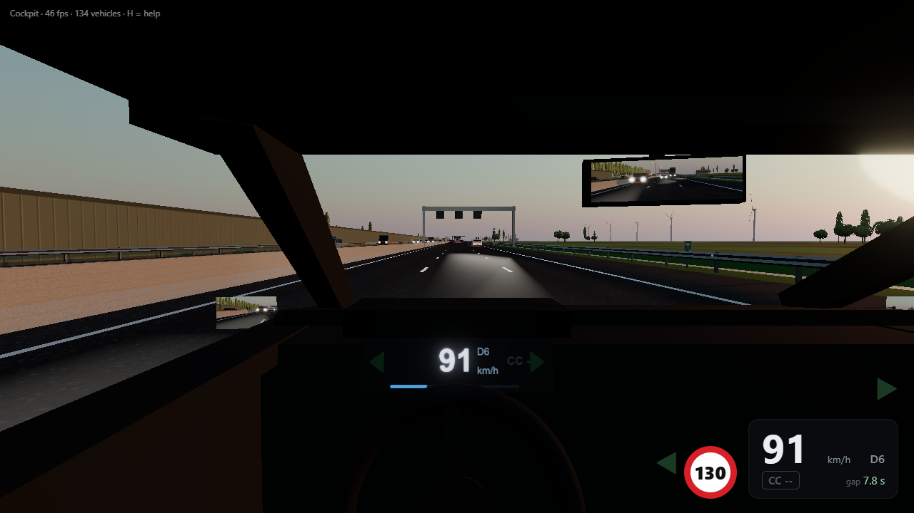

# Flow Driving

A calm traffic driving simulator set on Dutch roads: you're part of the flow, not racing through it.



## Play in your browser

<https://mostlikely4r.github.io/flow-driving/> — desktop Chrome, Edge or Firefox, with a keyboard.
No install.

## The vision

**An authentic Dutch driving simulator where the game is being part of traffic.**

Three pillars decide every argument, in this order ([docs/vision.md](docs/vision.md) has the vision
and the milestones, [BACKLOG.md](BACKLOG.md) every feature):

1. **Authentic.** Dutch rules, roads, signs and driver habits. When in doubt, do what really
   happens on the A12 at 17:30, not what is convenient or "gamey".
2. **Readable traffic.** You can see situations build up and predict how they will play out.
   Drivers show what they intend through their position, speed and signals, just as good real
   drivers do.
3. **Calm.** Nothing rewards speed, reflexes or risk. Pressure comes from the flow, never from a
   timer or a score.

Visual quality is a bar, not a pillar: it matters, but it never justifies a feature on its own.

## Run it locally

```
npm install
npm run dev        # opens http://localhost:5173
```

or double-click `start.bat` on Windows. `npm run build` writes the production build to `dist/`, and
`npm run preview` serves it.

`npm run dev` turns on the playtest tools: the drive journal (F8 marks, *End drive…*), the dev
overlay and `?scenario=` URLs. Add `?dev` to the hosted URL for the same; without it the game is the
plain player's game.

## Built with AI

The game is developed with Claude Code, in a plan → build → review loop: a spec per feature, a fresh
session to build it, and a review against the plan and the pillars. Those rules live in
[AGENTS.md](AGENTS.md) and the two commands in `.claude/commands/`; `CLAUDE.md`, `.pi/` and
`docs/specs/` are part of that workflow, not of the game.

## Contributing

An open project under MIT: better versions and forks are welcome. A pull request is judged by the
pillars above, in order, and by the headless checks. See [CONTRIBUTING.md](CONTRIBUTING.md) before
you start.

## License

MIT, see [LICENSE](LICENSE).

## For developers

Everything below is how the simulation works, what to tune, and the tools that check it.

### What's simulated

- **Traffic AI** (`src/traffic.js`): IDM car-following + MOBIL lane changes with Dutch rules:
  keep right, no overtaking on the right above ~55 km/h (some drivers break it when frustrated),
  trucks limited to the two right lanes at ~84 km/h with slow "elephant races", middle-lane hoggers,
  speeders, slow drivers. Drivers signal, wait for a gap, and cooperative drivers ease off to let
  a signalling car in, including **you** when you indicate. Flash your lights (F) at a left-lane
  dawdler and they'll move over sooner.
- **Your car** (`src/player.js`): power/drag physics, auto gearbox, cruise control in 1 km/h steps,
  optional ACC, curve-following steering assist for keyboard play.
- **Road** (`src/road.js`, `src/scenery.js`): endless procedural A-road with gentle clothoid curves,
  3 lanes plus a hard shoulder, concrete median barrier, guardrails, ditches, polder fields,
  hectometre posts, matrix-sign gantries, blue guide signs, 100 (6-19 h) / 130 (19-6 h) signs,
  viaducts, noise walls, lit stretches, farms, poplars, wind turbines, distribution centres
  (estates of 1-3 boxes with docks, trailers, an office and a lit logo) and **junctions** every
  3-6 km: exit signs, *afritbakens*, an exit lane, a bridge, and an on-ramp road that AI cars drive
  down onto the acceleration strip.
- Day (limit 100), dusk and night (limit 130). Live interior and side mirrors.

### Checks

No unit tests: the checks are headless tools in `tools/`, each an npm script. The full check before
a pull request:

```
npm run build
npm run simtest
npm run personas
npm run moments
npm run bottest
```

`npm run playtest` is the long one (minutes of traffic per seed, written to `playtests/bot/`).

`npm run simtest` runs the traffic model headless and prints lane usage, speeds and collisions
(options: `density=20 lanes=4 player=120 plane=2 limit=130 min=6`).
`node tools/shot.js <dir> [day|dusk|night]` takes screenshots in headless Chrome or Edge (run `npm run build` first).
The screenshot and clip tools find Chrome or Edge on their own; set `BROWSER_PATH` to the browser
executable when it sits somewhere unusual.

### Tuning

Most behaviour is in the in-game menu (Esc). Everything else is in `src/config.js`.
Useful knobs in `src/traffic.js` → `makeVehicle()`:

| What | Where |
|---|---|
| How eager cars are to keep right | `veh.bias` |
| How willing they are to let others in | `veh.p` (politeness), `veh.coop` |
| Following distance | `veh.T` (time headway, s) |
| Lane-change duration / signalling time | `veh.lcDur`, `veh.tSignal` |
| Accepted gap when changing lanes | `veh.tSafe`, `veh.tSafePlayer` |

### Persona viewer

`C` from the pause menu, or "Meet the cast" on the title card: a turntable rig on a
bare lane against black — only the road and the cars, the world is put away while it is open. `L` swaps
lamp signatures, `V` the camera, `G` the headway gap.
Every line on the spec sheet is clickable: the rig grows to the lanes a behaviour needs and plays a
seeded demo staged from `scenarios.js` (`demo:<persona>:<trait>`), with captions detected from the star
car's live state. `Space` pauses, `1`/`2` are 0.5×/0.25× slow motion, `3` normal, `R` restarts, and the
sheet's *Back to the turntable* button (or `Esc`) leaves a demo or the gap view.
`?scenario=demo:sok:draft` runs one as an ordinary free scenario (dev mode).
`npm run personas` runs all of them headless and fails if a tell never fires, a demo collides or an
expectation does not hold (`node tools/personas.js --verbose` prints the captions).

### Scenarios

`src/scenarios.js`: repeatable situations for tuning the AI, in dev mode only. Open
`http://localhost:5173/?scenario=elephant` (Backspace restarts, O cycles to the dev overlay), or run
`npm run scenario elephant` for a headless timeline of who signals, merges and brakes
(`you=ai` lets an AI drive your car; run without a name to list scenarios).

`npm run abtest -- anticipation=0 anticipation=1` compares traffic settings over many seeds
(hard braking, emergency stops, truck overtakes, lane changes, speed).

### Proefrit (the drive journal)

`src/journal.js`, `src/moments.js`, dev mode only. Every drive is recorded to one JSON journal.
`F8` drops a mark while you drive; the pause menu (Esc) takes a one-line note per mark and
an *End drive…* button asks three optional questions, then POSTs the journal to the Vite dev server
(`playtests/human/<date>-<time>.json` — git ignores these; they are design history and the calibration
set, and stay on your disk). Outside `npm run dev`, *End drive…* downloads the JSON instead.
`npm run report -- playtests/human/2026-01-31-17-42-09.json` turns a journal into `report.md`:
rates per 10 minutes for each moment kind, the M1 check, a from-the-seat timeline, your marks and
their nearby detectors, and a health block. `src/moments.js` judges only what a driver in the car
can see; thresholds live in `CONFIG.moments`. `npm run moments` runs the detector cases (hand-built
journals) and then the stage test (`tools/momentstage.js`), which drives five staged situations
through the real sim and checks that the brake-light, indicator, empty-signal and pointless-lane
detectors read what the sim actually recorded (`only=ID`, `trace`, `order=reverse`, `dump=<dir>`).

### Playtest bot

`src/perception.js`, `src/botDriver.js`, `tools/playtest.js`: a deterministic driver that has
nothing but the keyboard. It sees only what a driver in the car can see (a whitelist of cues, no
intent or hidden sim state), and its output is held keys plus key presses, so it goes through the
same pedal ramp, cruise-control clicks and indicators as you.
`npm run playtest -- driver=forens min=20 seeds=5 tod=day` runs one child process per seed (traffic
ids are a module global) and writes `playtests/bot/<run>/` with a journal per seed, a bot trace
(`seed-N.trace.json`), `run.json` (arguments, commit, timings, checks, pass/fail) and `report.md`
from the same `buildReport()` a human drive uses. Options: `driver=slak` (the slowcoach),
`scenario=closure`, `seed=N`, `until=T` (one seed; prints the player state, the nearest car per
lane from the percept, the bot state and the last trace lines, no report), `jobs=N`, `dt=1/60`,
`cfg.<key>=<value>` and `<profile>.<param>=<value>`. `npm run bottest` runs the headless tests:
perception geometry and range cut-offs, a throwing proxy over every vehicle, the import/DOM
whitelist, the drift cue, synthetic following/cut-in/indicator cases, and determinism.
`npm run signals -- <journal.json | run dir> …` counts AI signal episodes (signal to move, signals
withdrawn after 6 s or more, re-signals within 20 s and who blocked them) for a human drive or a bot run (F-38).

### Look-dev tools

`node tools/glare.js <dir>` sets up a night scene with cars close behind and oncoming, for checking headlight glare.
`node tools/speeds.js [dayDensity] [nightDensity]` reports wanted vs driven speeds per archetype and lane.

`node tools/lineup.js <dir>` parks one car of each archetype next to you (sides, fronts, mirror; day and night) for look-dev.
`node tools/clip.js <scenario> [seconds] [chase|bonnet|cockpit] [off|ar-rel|ar-abs|dev] [out.mp4]` records a video of a scenario (needs ffmpeg). It loads the game with `?dev`.
`node tools/nightroad.js <dir>` shows an empty unlit road lit only by your own lamps, then traffic.
`node tools/night.js <dir>` shoots the night mood on an unlit stretch and inside a sodium-lit one
(uses the `window.__game.teleport(s)` debug hook).

### Matrix signs and lane closures

`src/msi.js`, `src/closureView.js`: gantries every 500 m show a queue warning (flashing 50 / 70) behind slow traffic by themselves, and arrow / red cross / 70 around a lane closure. Closures appear at random in free play (`closuresPer10km`), or try `?scenario=closure` in dev mode. `node tools/closure.js [lanes] [density] [closedLane] [minutes]` checks safety and throughput headless.

### On-ramps and junctions

`src/junctions.js` places a junction every 3–6 km from s alone (block 0 fixed at 2500, so free play
meets one within a minute), nudged clear of the matrix and ANWB gantries. A junction is a place on
the road: a blue exit direction sign at 1200 m and at 600 m, the 3-2-1 *afritbakens* at 300/200/100
m, the exit lane opening (`exitStart`), its gore (`exitGore`), the bridge over the motorway, and
then the on-ramp road coming down from the crossing road to the acceleration strip. Both
carriageways get the same junction mirrored, and it is lit from the exit lane to the end of the
strip. Scenery draws it; nothing else has to know where a junction is.

`src/traffic.js` (`addRamp`, `stripLogic`, `mergeReady`): the ramp road and the acceleration strip
(`invoegstrook`) are both lane −1 — the ramp road upstream, the strip from `s0` to `s1`. Cars appear
at the top of the ramp road at ~50 km/h (trucks 35), drive down it, indicate left from 100 m before
the strip, speed up to lane-0 speed and merge into the first safe gap; near the end they take a
tight zipper gap. Over the second half of the strip the speed-match gate widens by `mergeRelaxKmh`,
and a merger that is too fast for lane 0 eases toward its speed (a virtual leader, above
`mergeLiftMinKmh`) instead of overtaking it on the strip. A merger gives way, and lane 0 makes no
room on purpose — measured, see F-20. No car appears out of thin air on the motorway, and none
appears while you are within `rampSpawnHoldM` of a ramp top.

**The run-out** (F-20 slice 4): the paint ends at `s1`, but a car that found no gap there does not
stand still. It keeps rolling for `rampRunoutM` (150 m) along the hard shoulder, indicating left, at
`runoutUnderKmh` (5 km/h) under the lane-0 car alongside or within 30 m — floored at 15 km/h so it
never crawls beside a queue — and never undertakes lane 0 on the shoulder. From the middle of the
strip on, and along the run-out, it takes the Dutch gap instead of a big one: `mergeFollowM` (9 m,
two car lengths) in front of a follower that need brake no harder than `mergeFollowB` (3 m/s²) by
`idm` — firm, but short of the −4 the tool counts as hard, and the IDM term carries the closing
speed, so this makes merging at speed easy, not pulling out from a standstill. With you as the
follower the limit is the zipper's 1.8. The first half of the strip and every ordinary lane change
keep the old gap tests. Only with lane 0 jammed the whole way does a merger stop, at the end of the
run-out (`r.sEnd`): an invisible, AI-only stop marker. There is no wall there for you — past a
strip the hard shoulder is just the hard shoulder, and a run-out car follows you on it. The lane map
draws the run-out in a lighter tone than the strip, and the dev overlay says "run-out · 60 m left".

Free play adds one ramp per junction while it is in the simulated range (`rampsFreePlay`, off =
scenery only), at `rampPerMin × densityScale`. `?scenario=onramp` places you at junction 0, before
the exit lane and the bridge; `onramp-busy` is the same junction with twice the traffic and twice
the ramp flow. `npm run onramp [lanes=3] [density=12] [perMin=6] [minutes=10] [seed=7] [road=400]`
measures merges (and how many of them are in the run-out), gaps, stops and where they stood (on the
strip, in the run-out, at the hard end), stops per merge, ramp-road time, speed at the end of the
ramp road, follower braking under −2 and under −4, lane-0 speed near the ramp, throughput, the merge
gate (seconds spent faster or slower than the speed a merger compares itself with) and courtesy (how
often lane 0 could make room and the merger used it), and prints one `JSON` line with `--json`
(`road=0` is the slice-1 strip without a ramp road; `CFG_<key>=<value>` overrides, as in
`closure.js`). `npm run onrampsuite` runs the 24-run matrix (2 and 3 lanes × density 8/12/16 ×
seeds 7/8/9/10, about 4 minutes), prints it with those columns and checks the section 3 lines of the
current F-20 plan as pass/fail against `tools/onramp-baseline.json`; `--save` writes that baseline,
`--runs=4` runs only the first four density-8 runs. Knobs: `rampRoadM`, `rampTopKmh`,
`rampStripM`, `rampRunoutM`, `runoutUnderKmh`, `rampPerMin`, `rampSpawnHoldM`, `rampEntryKmh`,
`mergeKmhDefault`, `mergeRelaxKmh`, `mergeLiftMinKmh`, `mergeLastM`, `mergeFollowM`, `mergeFollowB`,
`junctionEveryKm`, `rampsFreePlay` in `config.js`, plus `mergeKmh` per archetype.

### Lane map

`src/lanemap.js`, U: overhead view of your carriageway, cars coloured by speed; press U again for a time-space diagram of your lane (waves show as bands creeping down). `,` `.` zoom. `?scenario=wave` provokes one (dev mode); `node tools/wave.js` measures how it grows or damps.

### Radio

`src/radio.js`, Y: your own music folder (menu, Esc), or a stream URL of your own pasted into
the menu. No built-in stations: a game on GitHub should not hard-link a broadcaster's streams.
Streams use a plain `<audio>` element on purpose: routing cross-origin streams through Web Audio
plays silence. On the hosted (https) build an `http://` stream is refused with a toast, because the
browser would block it as mixed content.

### Driver archetypes

`src/archetypes.js`: a persona sets both a car's look (paint, stance, tint,
light signature) and, about 70% of the time, its driving style. Leasebak, Patser, Pensioner,
Grijze sok (slipstreams trucks, `?scenario=sok`), Family, White van and EV smoothie; `?scenario=cast` shows them all (dev mode); `archetypes` in config.js scales how common they are. Try `?scenario=archetypes`.
